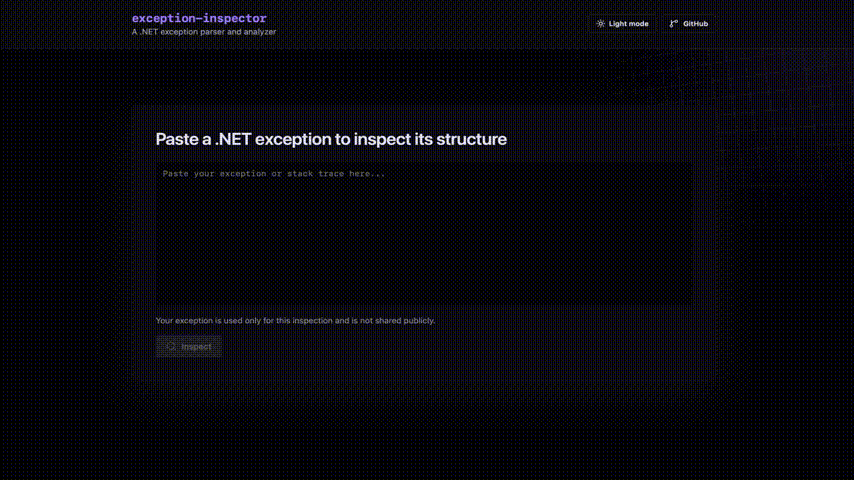

# Exception Inspector

> A .NET exception parser and analyzer



<p>
  <a href="https://jakub022.github.io/exception-inspector/"><strong>Try it out →</strong></a>
  &nbsp;&nbsp;
</p>

## Project description

- Turns pasted .NET exceptions and stack traces into a readable report showing
  what went wrong, where it surfaced in the application, and what to check next
- Designed with privacy in mind: input is not logged, and shared reports redact
  file paths, email addresses, IP addresses, secrets, and tokens
- Share links let developers send a sanitized report to someone else without
  sharing the original exception text (valid for 7 days)

## Run locally

### Prerequisites

- .NET 10 SDK
- Node.js
- pnpm

### Start the API

From the repository root:

```bash
dotnet run --project src/ExceptionInspector.Api
```

The API runs on `http://localhost:8080`.

### Start the frontend

In a second terminal:

```bash
cd client
pnpm install
pnpm dev
```

Open the local Vite URL shown in the terminal. The development client uses the
mock API by default, so the interface can also be explored without starting the
backend.

### Run checks

From the repository root:

```bash
dotnet build ExceptionInspector.slnx
dotnet test ExceptionInspector.slnx
```

For frontend checks:

```bash
cd client
pnpm lint
pnpm build
```

## Technical details

### Backend

- C# / .NET 10 with ASP.NET Core minimal APIs
- Separate C# core library for parsing, analysis rules, and redaction
- REST API with OpenAPI, validation, ProblemDetails, health checks, CORS, and
  rate limiting
- EF Core and SQL Server for share links, migrations, expiration, and secure
  token handling
- Dependency injection with in-memory storage locally and SQL Server in
  production

### Testing and delivery

- xUnit tests covering parsing, analysis rules, redaction, API services, and
  persistence
- Dockerized ASP.NET Core API running as a non-root container
- Frontend hosted on GitHub Pages; production API running on Azure Container
  Apps with data stored in Azure SQL Database
- GitHub Actions CI/CD for builds, tests, GHCR image publishing, deployment,
  and health-check smoke tests

### Frontend

- React / TypeScript client built with Vite, using a mock API locally and the
  deployed API in production
- Lightweight UI built with Tailwind CSS, daisyUI, Lucide icons, and Shiki
  syntax highlighting
